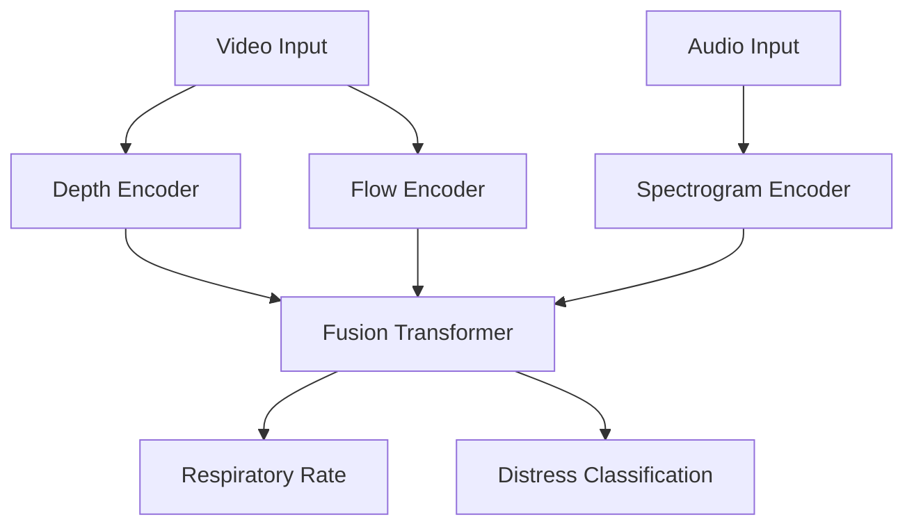

# Audio Dataset Strategy (Phase 17)

## 1. Overview
You have acquired two valuable audio datasets:
1.  **ICBHI 2017 Challenge Dataset**
    *   **Location**: `data/ICBHI_final_database`
    *   **Format**: `.wav` audio files + `.txt` annotation files (start_time, end_time, crackles, wheezes).
    *   **Metadata**: `filename_format.txt` describes patient ID, recording index, chest location (Trachea, Anterior/Posterior/Lateral), acquisition mode, and equipment.
    *   **Diagnosis**: `data/Respiratory_Sound_Database/patient_diagnosis.csv` links patient IDs to conditions (COPD, Healthy, URTI, Bronchiectasis, Pneumonia, Bronchiolitis, Asthma, LRTI).
2.  **Respiratory Sound Database**
    *   **Location**: `data/Respiratory_Sound_Database`
    *   **Notes**: Appears to be a parent directory or related collection.
    
These datasets contain lung sounds (wheezing, crackles, tachypnea) which provide complementary information to the video-based chest movement analysis.

## 2. Integration Strategy
**Do not mix these with the current video pipeline yet.** Video processing uses Optical Flow and Depth, while Audio processing requires Mel-Spectrograms.

### Recommended Pipeline (Phase 17)
We will upgrade the `TemporalFusionTransformer` to be **Tri-Modal**:

### Recommended Pipeline (Phase 17)
We will upgrade the `TemporalFusionTransformer` to be **Tri-Modal**:

## 3. Immediate Actions
1.  **Storage**: Keep audio files in `data/datasets/audio/`.
2.  **Preprocessing**:
    *   Convert `.wav` files to **Log Mel-Spectrograms**.
    *   Split into 10-second clips to match video windowing.
3.  **Modeling**:
    *   We will use an **AudioMAE** (Masked Autoencoder for Audio) or **VGGish** backbone.
    *   We can pre-train this branch independently before fusion.

## 4. Next Steps
Once the current Video Foundation Model (Phase 15/16) is stable, we will launch **Phase 17: Audio-Visual Fusion**.
